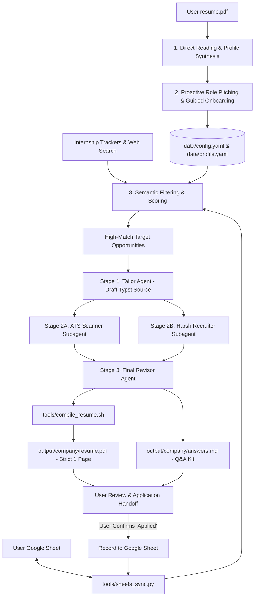

# Internship Hunter & Multi-Agent Resume Refinery

This skill equips you with the complete operational workflow to help candidates discover, filter, tailor, and apply to high-probability tech internships.

---

## Architecture Overview



---

## Core Workflows

### Workflow 1: Candidate Onboarding & Proactive Role Matching
**When to run**: At the start of a project or when a new `resume.pdf` is provided.

1. **Locate and Ingest Resume**:
   - Check the workspace root or `data/` for `resume.pdf` or `base_resume.pdf`.
   - Read the document directly using `read_file` or extract layout text using `pdftotext -layout <resume.pdf> -`.
   - Extract the candidate's core achievements, education, technical stack, and projects into `data/profile.yaml`.

2. **Semantic Role Analysis**:
   - Analyze the candidate's engineering depth, architecture skills, coursework, and projects.
   - Formulate the **top 3-4 recommended internship roles** (e.g. *Systems / Low-Level Engineer*, *Backend / Distributed Systems Intern*, *ML / AI Infrastructure Intern*, *Full-Stack / Frontend Intern*).
   - For each recommended role, provide a 1-sentence technical rationale linking to their specific projects.

3. **Interactive Guided Interview**:
   - Present the recommended roles to the user.
   - Ask the user to confirm/adjust their preferences:
     - Preferred target roles.
     - Target countries (e.g., United States, Canada, Remote, UK).
     - Work authorization / visa sponsorship status (e.g., *Requires sponsorship*, *F-1 CPT/OPT eligible*, *Authorized without sponsorship*).
     - Target internship season (e.g., *Summer 2025*, *Fall 2025*, *Summer 2026*).
   - Save the finalized preferences into `data/config.yaml`.

---

### Workflow 2: Google Sheets Synchronization & Deduplication
**When to run**: Before recommending new jobs (deduplication) and strictly after the user confirms an application was submitted.

1. **Deduplication Check**:
   - Before presenting an internship to the user, run:
     ```bash
     python3 .agents/skills/internship-hunter/tools/sheets_sync.py --check-duplicate --company "<Company>" --role "<Role>"
     ```
   - If exit code is 2 (`DUPLICATE`), skip this role to prevent duplicate applications.

2. **Recording Confirmed Applications**:
   - Never record to Google Sheets prematurely during drafting or compilation.
   - Only after the user inspects the PDF, visits the portal, and confirms application submission (e.g. *"Applied"*), log the entry:
     ```bash
     python3 .agents/skills/internship-hunter/tools/sheets_sync.py --append \
       --company "<Company>" \
       --role "<Role>" \
       --location "<Location>" \
       --url "<JobURL>" \
       --status "Applied" \
       --score "<Score>" \
       --resume-path "output/<company>/resume.pdf"
     ```

---

### Workflow 3: Internship Search & Fit Evaluation
**When to run**: When looking for active opportunities matching the candidate profile.

1. **Sourcing Postings**:
   - Search fresh postings using `search_web` or by reading active GitHub internship tracker repos:
     - `SimplifyJobs/Summer2025-Internships` (or target year)
     - `pittcsc/Summer2025-Internships`
   - Extract: Company, Role, Location, Terms, Sponsorship tags, and Application URL.

2. **Semantic Fit Scoring**:
   - Evaluate each posting against `data/config.yaml`:
     - Disqualify if visa policy conflicts with candidate's authorization.
     - Disqualify if location is out of scope.
     - Disqualify if already recorded in Google Sheets.
   - Compute a Semantic Match Score (0-100) based on how well the candidate's projects match the core responsibilities.
   - Present a ranked table of the top opportunities for the user to select.

---

### Workflow 4: The 3-Stage Actor-Critic Resume Tailoring Pipeline
**When to run**: When tailoring a resume for a selected target job.

#### Stage 1: The Tailor Agent
- **Instructions**: See [tailor_strategy.md](./prompts/tailor_strategy.md).
- Draft a role-specific Typst resume source file at `output/<company>_<role>/resume.typ`.
- Adhere strictly to the **Google XYZ formula** (`Accomplished [X] as measured by [Y] by doing [Z]`).
- Lead with the most relevant projects and stack matching the job description.
- **Rule of Integrity**: Never hallucinate unverified skills or experiences.

#### Stage 2: Dual Critique (ATS Scanner + Harsh Recruiter)
Run two specialized evaluation lenses on the Stage 1 draft:

1. **Subagent 2A: The ATS Scanner**
   - **Persona**: See [ats_scanner.md](./prompts/ats_scanner.md).
   - Generates algorithmic score, keyword match matrix, and identifies missing required keywords.

2. **Subagent 2B: The Harsh Recruiter**
   - **Persona**: See [harsh_recruiter.md](./prompts/harsh_recruiter.md).
   - Role-plays a cynical hiring manager with 10 seconds of attention.
   - Tears apart passive voice, vague metrics, and tutorial clones.
   - Produces a brutal score (0-100) and line-by-line corrections.

Save both critiques into `output/<company>_<role>/feedback.md`.

#### Stage 3: The Final Revisor Agent
- **Instructions**: See [revision_strategy.md](./prompts/revision_strategy.md).
- Implement all valid critiques: inject missing keywords (where factual), replace weak verbs, and quantify metrics.
- Compile the Typst source using the 1-page enforcement tool:
  ```bash
  .agents/skills/internship-hunter/tools/compile_resume.sh output/<company>_<role>/resume.typ output/<company>_<role>/resume.pdf
  ```
- If the tool warns that the page budget was exceeded, adjust line spacing and word count until it is **strictly 1 single page**.
- Generate `output/<company>_<role>/answers.md` containing pre-crafted answers for standard application questions ("Why this company?", "Challenging project").

#### Stage 4: User Review & Application Handoff
- Present the candidate with:
  1. The compiled PDF path (`output/<company>_<role>/resume.pdf`) for inspection.
  2. The direct application URL.
  3. Key application highlights and pre-drafted answers from `output/<company>_<role>/answers.md`.
- Prompt the user to open the link, apply (using their preferred autofill tool/extension), and reply when submitted.

#### Stage 5: Post-Application Google Sheets Sync & Batch Advancement
- When the user confirms application submission (*"Applied"*):
  1. Append the record to Google Sheets with `--status "Applied"`:
     ```bash
     python3 .agents/skills/internship-hunter/tools/sheets_sync.py --append \
       --company "<Company>" \
       --role "<Role>" \
       --location "<Location>" \
       --url "<JobURL>" \
       --status "Applied" \
       --score "<Score>" \
       --resume-path "output/<company>_<role>/resume.pdf"
     ```
  2. If executing a multi-role queue or batch loop, immediately proceed to the next target role and start Stage 1 for the next opportunity.

---

### Workflow 5: Profile Maintenance & Incremental Updates
**When to run**: When the user gains new experiences, ships a project, or uploads a revised PDF.

1. **Conversational Incremental Additions**:
   - When the user says e.g., *"I just added a new project / started a new role..."*, update `data/profile.yaml` directly.
   - Retain all historical projects and metrics in `data/profile.yaml` so the Tailor Agent can choose from an expanding inventory of accomplishments.

2. **Full Resume PDF Refresh**:
   - If the user replaces `resume.pdf` with a new version, re-read the file.
   - Update `data/profile.yaml` while preserving any custom notes or user-refined metrics.
   - Keep `data/config.yaml` (roles, countries, sponsorship, Google Sheet settings) persistent across updates.

