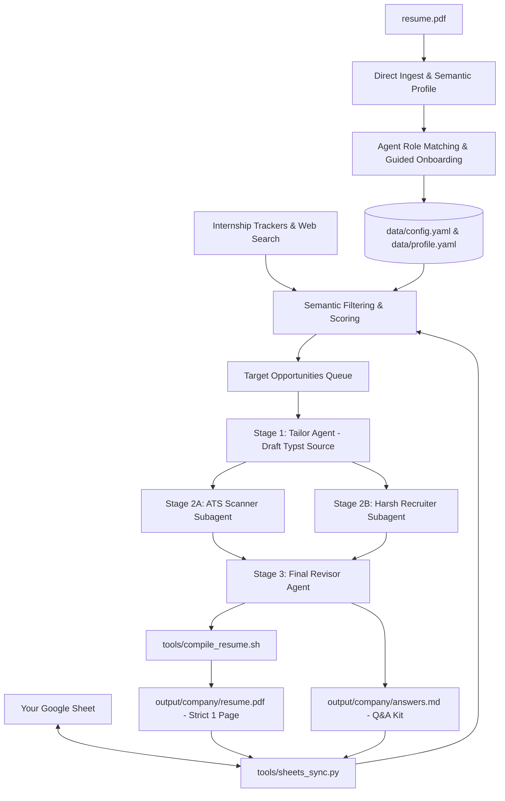

# 🎯 AI Internship Hunter & Multi-Agent Resume Refinery

An autonomous, multi-agent skill suite designed for **Antigravity** (and agentic coding assistants) to discover, filter, critique, and tailor applications for tech internships.

---

## ⚡ Key Capabilities

- 📄 **Direct Resume PDF Ingestion**: Natively extracts your background, projects, coursework, and technical stack.
- 🧭 **Proactive Role Suggestion**: The Agent analyzes your engineering depth and pitches the highest-probability internship tracks (e.g. Systems/Low-Level, Backend/Distributed Systems, ML Infrastructure) with technical rationale.
- 📊 **Google Sheets Sync & Deduplication**: Integrates directly with your Google Sheets tracker to read past applications and ensure you **never duplicate apply**. Automatically logs newly tailored applications with match scores and PDF links.
- 🔍 **Semantic Internship Search**: Discovers and filters active internship postings based on your target roles, graduation year, target countries, and visa sponsorship requirements.
- 🎭 **Actor-Critic Tailoring Loop**:
  - **Stage 1 (Tailor Agent)**: Synthesizes a role-specific Typst resume draft using the Google XYZ formula (`Accomplished [X] as measured by [Y] by doing [Z]`).
  - **Stage 2A (ATS Scanner Subagent)**: Evaluates hard keyword coverage, entity density, and parsing hygiene.
  - **Stage 2B (Harsh Recruiter Subagent)**: Adopts a ruthless, cynical senior hiring manager persona (10-second scan mindset) to tear apart passive voice, vague metrics, and fluff.
  - **Stage 3 (Final Revisor Agent)**: Adjudicates feedback, tightens copy, and compiles a pixel-perfect **strict 1-page PDF** via **Typst**.
  - **Application Q&A Kit**: Generates tailored answers for application prompts ("Why this company?", "Challenging technical project").

---

## 🏗️ Architecture



---

## 🚀 Quickstart

### 1. Clone & Set Up Environment
```bash
git clone https://github.com/your-username/internship-hunter.git
cd internship-hunter

# Run automated setup (creates virtual environment and downloads standalone Typst compiler)
./setup.sh
```

### 2. Add Your Resume
Place your base resume PDF into the project root:
```bash
cp /path/to/my_resume.pdf ./resume.pdf
```
*(Don't worry: `*.pdf`, `credentials.json`, and personal data are strictly ignored in `.gitignore` and will never be committed to Git).*

### 3. Launch Antigravity
Start your session in the workspace:
```bash
agy
```
Then prompt the agent:
> *"I placed my `resume.pdf` in the workspace. Ingest it, suggest my best-matching internship roles, and let's configure my preferences."*

The agent will activate the `internship-hunter` skill, read your resume, pitch matching roles, and guide you through target countries and visa sponsorship preferences.

---

## 📊 Google Sheets Setup (Optional but Recommended)

To prevent duplicate applications and automatically track tailored resumes:

1. **Create a Google Cloud Project & Service Account**:
   - Go to the [Google Cloud Console](https://console.cloud.google.com/).
   - Create a project and enable the **Google Sheets API** and **Google Drive API**.
   - Create a **Service Account**, generate a JSON key, and save it as `credentials.json` in the project root.
2. **Share Your Google Sheet**:
   - Open your internship tracking Google Sheet.
   - Click **Share** and add your Service Account email (e.g., `internship-bot@project-id.iam.gserviceaccount.com`) as an **Editor**.
3. **Configure `data/config.yaml`**:
   ```yaml
   google_sheets:
     enabled: true
     spreadsheet_id: "YOUR_SPREADSHEET_ID_FROM_URL"
     worksheet_name: "Applications"
     credentials_path: "credentials.json"
   ```
4. **Test the Connection**:
   ```bash
   ./.venv/bin/python3 .agents/skills/internship-hunter/tools/sheets_sync.py --test-connection
   ```

---

## 📂 Repository Structure

```
.
├── .agents/
│   ├── rules/
│   │   └── resume_integrity.md            # Anti-hallucination rules (zero false claims)
│   └── skills/
│       └── internship-hunter/
│           ├── SKILL.md                   # Master Agent Runbook
│           ├── prompts/
│           │   ├── ats_scanner.md         # Stage 2A: Algorithmic ATS Scanner persona
│           │   ├── harsh_recruiter.md     # Stage 2B: Cynical Hiring Manager persona
│           │   ├── tailor_strategy.md     # Stage 1: STAR/XYZ tailoring strategy
│           │   └── revision_strategy.md   # Stage 3: Polish and Q&A strategy
│           ├── templates/
│           │   └── resume_template.typ    # Clean ATS-optimized Typst resume template
│           ├── tools/
│           │   ├── compile_resume.sh      # Typst compiler with strict 1-page check
│           │   └── sheets_sync.py         # Google Sheets I/O & deduplication tool
│           └── references/
│               ├── ats_guidelines.md      # ATS formatting standards
│               └── recruiter_rubric.md    # Harsh recruiter scoring criteria
├── data/
│   ├── profile.example.yaml               # Reference schema for candidate profile
│   └── config.example.yaml                # Reference schema for preferences & filters
├── requirements.txt                       # Minimal Python dependencies (pyyaml, gspread, requests)
├── setup.sh                               # One-click environment installer
├── .gitignore                             # Protects private resumes, keys, and outputs
└── README.md
```

---

## 🔒 Security & Privacy

Your personal data is protected by design:
- All `*.pdf` files, `data/profile.yaml`, and `output/` folders are ignored in `.gitignore`.
- API keys, `credentials.json`, and service account tokens are ignored.
- The agent adheres to `.agents/rules/resume_integrity.md`, ensuring it never fabricates skills, dates, or experiences.

---

## 📜 License
MIT License. See [LICENSE](LICENSE) for details.
